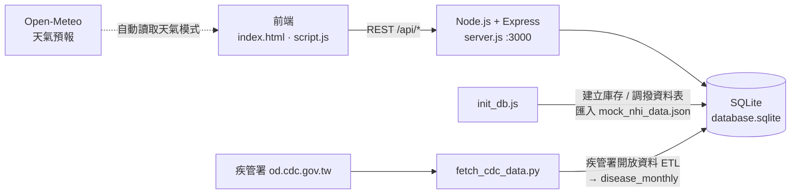

# 💊 SmartPharma — 偏鄉智慧藥局聯合調度系統（PoC）

以桃園市大溪、復興區為場景的偏鄉藥局聯合調度平台。把分散在各家特約藥局的庫存串在一起，讓藥局之間可以互相調撥藥品，民眾可以線上預約慢性病連續處方箋，並依天氣與季節性疾病資料，提前調高偏鄉據點的安全庫存。

> 本專案為概念驗證（Proof of Concept），藥品、庫存、金流皆為模擬資料。

---

## 👥 四種角色

| 角色 | 主要功能 |
|---|---|
| 🏠 **復興區居民** | 線上預約慢箋領藥、上傳處方、模擬刷卡付款、追蹤藥品配送進度 |
| 💊 **特約藥局藥師** | 查詢跨店庫存、審核處方預約、發起與處理同業調撥申請 |
| 🚚 **物流專車司機** | 接收調撥任務、即時導航與配送進度回報 |
| 🏛️ **衛生局主管／區長** | 全區庫存總覽、調撥物流追蹤、季節性疾病與用藥分佈預測圖 |

---

## ✨ 功能亮點

- **跨店庫存與雙向調撥**：藥局缺藥時可向鄰近藥局發起調撥，對方審核後由物流專車配送（待審核 → 已核准出庫 → 專車配送中）
- **依天氣調整安全庫存**：可切換晴天、大雨特報、颱風警戒，或選「自動讀取 API」由 Open-Meteo 取得復興區當日降雨預報。大雨時安全水位調高為 1.5 倍、颱風為 2 倍，預防山區道路中斷
- **低於水位自動補貨**：庫存跌破安全水位時，系統依規則自動向最近、有庫存的藥局發出調撥請求，並避免重複發單
- **相似替代藥建議**：原藥缺貨時提供同成分或同類替代藥選項
- **季節性疾病預測圖**：用疾管署開放資料（流感、腸病毒、腹瀉的健保就診人次），畫出各縣市每月就診趨勢，作為備藥參考

---

## 🏗️ 系統架構



### 疾管署資料 ETL（`fetch_cdc_data.py`）

- **Extract**：下載疾管署 JSON，原始檔快取在 `cdc_raw/`
- **Transform**：依「疾病 × 年 × 月 × 縣市」彙整就診人次，週資料換算成月份，「臺／台」統一
- **Load**：用參數化查詢寫入 SQLite 的 `disease_monthly` 資料表，每個疾病以一筆交易整批更新
- **API**：`GET /api/disease-seasonal?county=桃園市` 回傳最近 5 個完整年度的每月平均就診人次與占全年比例
- 還沒執行過 ETL 時，圖表會顯示示意資料並加註說明

---

## 🧰 技術棧

- **前端**：HTML、CSS、原生 JavaScript
- **後端**：Node.js、Express 5、sqlite3
- **資料處理**：Python（疾管署與氣象署開放資料）
- **資料庫設計**：`database_schema.sql`（完整的 MySQL 資料庫設計，含站點、使用者、藥品、批號、處方、調撥、疫情、天氣等資料表）

---

## 🚀 快速開始

```bash
# 1. 安裝依賴
npm install

# 2. 建立 SQLite 資料庫並匯入模擬藥品與庫存
node init_db.js

# 3.（選用）下載疾管署資料，供季節性疾病預測圖使用
pip install truststore              # od.cdc.gov.tw 憑證鏈不完整，需改用系統憑證庫
python fetch_cdc_data.py            # 下載並寫入 database.sqlite
python fetch_cdc_data.py --offline  # 不連網，用 cdc_raw/ 上次下載的原始檔重建

# 4. 啟動伺服器
node server.js
```

打開 http://localhost:3000/index.html ，選擇角色登入即可體驗。後台也可以呼叫 `POST /api/reset` 把資料庫重設回初始狀態。

介面上的「自動讀取 API」天氣模式使用 Open-Meteo，不需要金鑰。另外的 `fetch_weather_data.py` 會抓中央氣象署的鄉鎮天氣預報並輸出成 SQL；使用前先到[中央氣象署開放資料平台](https://opendata.cwa.gov.tw/index)申請授權碼，填入 `CWA_API_KEY`。

---

## 📁 專案結構

```text
.
├─ index.html / script.js / style_final.css   # 前端介面與邏輯
├─ server.js               # Express API 伺服器
├─ init_db.js              # 建立 SQLite 資料表並匯入模擬資料
├─ mock_data_generator.js  # 依健保署藥品主檔格式產生模擬資料
├─ mock_nhi_data.json      # 模擬藥品與各藥局庫存
├─ fetch_cdc_data.py       # 疾管署季節性疾病資料 ETL
├─ fetch_weather_data.py   # 中央氣象署鄉鎮天氣預報 → weather_data.sql
├─ database_schema.sql     # 完整 MySQL 資料庫設計
├─ nidss_data.sql          # 法定傳染病統計資料
├─ api.jsp                 # 早期的 JSP 版 API（已由 server.js 取代）
└─ replace_localstorage.js # 從 localStorage 改為 API 同步時用的遷移腳本
```

---

## 🗺️ 示範據點

德怡藥局、新資生連鎖藥局（復興店、康莊店）、大樹連鎖藥局（大溪康莊店）、資生大藥局，以及桃園市物流總部（HQ）。

---

## ⚠️ 聲明

本系統為課程概念驗證作品。藥品、庫存與金流皆為模擬，不可用於實際醫療或藥品調度。
